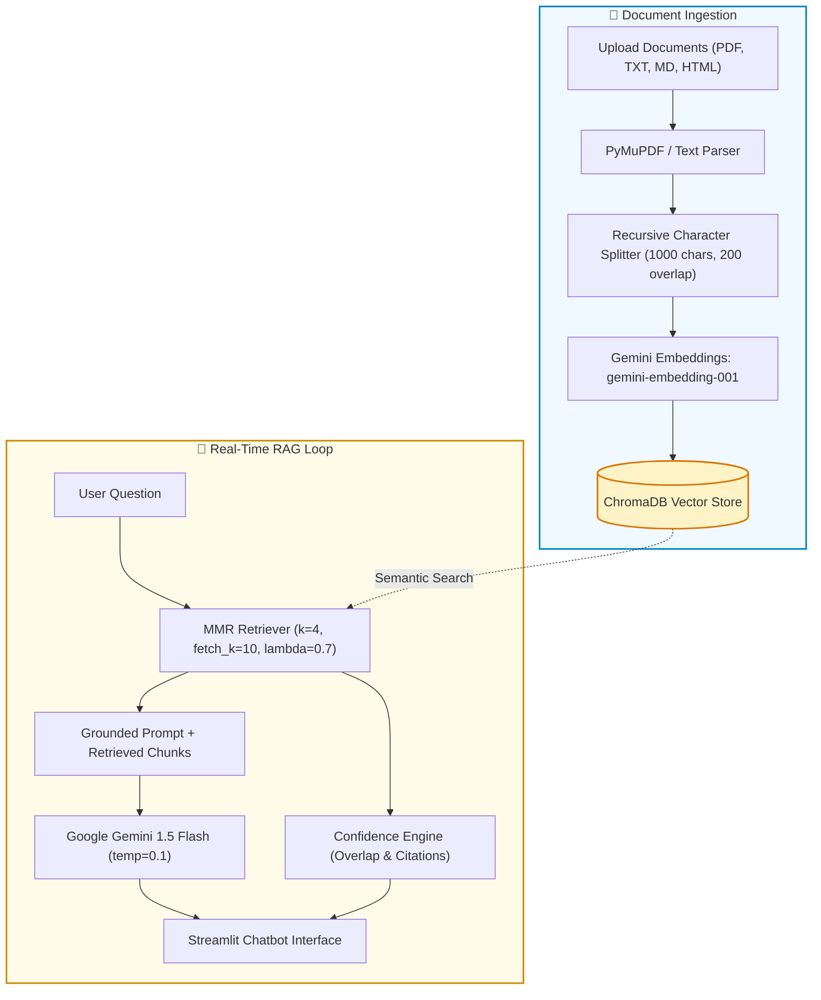

# ⚡ Enterprise Doc Q&A Assistant

<div align="center">


**A high-precision, evidence-grounded RAG assistant that answers questions across enterprise manuals, detects policy conflicts, and provides real-time confidence scores.**

[The Problem](#-the-problem--solution) • [Key Features](#-key-features) • [Architecture](#-architecture) • [Judge's Demo Simulation](#-live-demo-simulation) • [3-Step Quickstart](#-quickstart-for-evaluators) • [Demo Test Prompts](#-hackathon-demo-queries)

---

</div>

## 📑 Table of Contents
- [🎯 The Problem & Solution](#-the-problem--solution)
- [✨ Key Features](#-key-features)
- [🏗️ Architecture & Pipeline](#-architecture--pipeline)
- [💻 Live Demo Simulation](#-live-demo-simulation)
- [📁 Project Layout](#-project-layout)
- [🚀 Quickstart for Evaluators](#-quickstart-for-evaluators)
- [⚙️ Tech Stack & Configurations](#️-tech-stack--configurations)
- [📊 Real-Time Confidence Engine](#-real-time-confidence-engine)
- [🧪 Hackathon Demo Queries (Copy-Paste)](#-hackathon-demo-queries)

---

## 🎯 The Problem & Solution

| The Challenge in Enterprises | Our Hackathon Solution |
|:---|:---|
| ❌ **Hallucinations**: Generic chatbots invent policies and technical numbers. | ✅ **Zero-Guess Grounding**: Refuses to speculate if context is missing. |
| ❌ **Conflicting Versions**: Different manuals (v1.0 vs v2.0) state conflicting rules. | ✅ **Discrepancy Detection**: Identifies and flags contradictory docs. |
| ❌ **Black-Box Answers**: Users don't know where answers came from. | ✅ **Page-Level Citations**: Quotes the exact source file and page index. |
| ❌ **Unknown Reliability**: No way to verify response accuracy. | ✅ **Dynamic Confidence Score**: Evaluates retrieval match and source overlap. |

---

## ✨ Key Features

<details open>
<summary><b>🔍 1. Grounded Answers with Exact Citations</b></summary>
<br>

- Every answer cites the **source file** and **page number** (e.g., `Source: handbook.pdf (Page: 12)`).
- Strict refusal trigger: If information is not in the uploaded documents, it responds honestly:  
  `"I could not find this information in the authorised documentation sources."`
</details>

<details open>
<summary><b>⚠️ 2. Cross-Document Conflict & Version Detection</b></summary>
<br>

- Analyzes divergent policies across multiple files.
- If Document A says *"Overtime is approved by Team Lead"* while Document B says *"Overtime requires Director sign-off"*, the assistant **explicitly highlights the conflict** instead of picking one at random.
</details>

<details open>
<summary><b>📊 3. Dynamic Confidence & Factuality Scoring</b></summary>
<br>

- Real-time rating (0% to 100%) computed on the fly:
  - 🟢 **High (80-100%)**: Strong keyword overlap and verified page citation.
  - 🟡 **Moderate (50-79%)**: Partial overlap or indirect source citation.
  - 🔴 **Low / Fallback (0-49%)**: Insufficient context or fallback triggered.
- Includes an interactive **expander** showing why the score was assigned.
</details>

<details>
<summary><b>📂 4. Multi-Format Document Ingestion</b></summary>
<br>

- Ingests **PDF**, **TXT**, **Markdown**, and **HTML** files on the fly.
- Uses **PyMuPDF** for PDF page-by-page extraction and LangChain text splitters (1000 chunk size / 200 overlap).
- Powered by persistent **ChromaDB** with **Maximal Marginal Relevance (MMR)** search for balanced context diversity.
</details>

---

## 🏗️ Architecture & Pipeline



---

## 💻 Live Demo Simulation

See how the assistant presents answers during a live demonstration:

<details open>
<summary><b>👀 Demo 1: Grounded Response with Page Citation</b></summary>

```markdown
👤 User: What is the maintenance window schedule for production database servers?
```

> **🤖 Assistant:**
> Production database maintenance is scheduled every **Saturday between 02:00 UTC and 04:00 UTC**. During this window, read-only replica traffic is automatically diverted.
> 
> **Source:** `infrastructure_sop.pdf` (Page: 8)  
>
> 🟢 **Confidence: 95.0% (High)**
> <details>
> <summary>🔍 Verification & Source Breakdown</summary>
>
> - ✅ Explicit source citations detected.
> - ✅ Strong keyword overlap (88%) with retrieved chunks.
> </details>

</details>

<details>
<summary><b>👀 Demo 2: Conflict & Version Discrepancy Highlight</b></summary>

```markdown
👤 User: What is the maximum expense allowance for travel meals?
```

> **🤖 Assistant:**
> ⚠️ **Documentation Conflict Detected:**
> - According to **`travel_policy_2023.pdf` (Page: 4)**, the daily meal limit is **\$50/day**.
> - However, **`travel_policy_2024_update.pdf` (Page: 2)** amends this figure to **\$75/day**.
>
> Please confirm with HR whether the 2024 amendment is in effect for your department.
>
> 🟡 **Confidence: 75.0% (Moderate)**

</details>

<details>
<summary><b>👀 Demo 3: Honest Refusal (No Hallucination)</b></summary>

```markdown
👤 User: What are the ingredients in the cafeteria sandwich?
```

> **🤖 Assistant:**
> I could not find this information in the authorised documentation sources.
>
> 🔴 **Confidence: 0.0% (None - Fallback Triggered)**
> <details>
> <summary>🔍 Verification & Source Breakdown</summary>
>
> - ⚠️ The model could not find matching evidence in the context.
> </details>

</details>

---

## 📁 Project Layout

```text
d:\doomsday\
├── apps/
│   ├── bot.py             # Streamlit web interface & chat workflow
│   ├── rag_engine.py      # LangChain RAG pipeline, ChromaDB & Gemini models
│   ├── confidence.py      # Heuristic confidence & citation overlap scoring
│   └── api_test.py        # Diagnostic script to verify Google API key
├── chroma_db/             # Local ChromaDB persistent vector database
├── .env                   # Environment file (GOOGLE_API_KEY)
└── requirements.txt       # Dependencies
```

---

## 🚀 Quickstart for Evaluators

Get the app running in under 2 minutes:

### 1. Clone & Activate Virtual Environment
```powershell
# Open project directory
cd d:\doomsday

# Create & activate virtual environment
python -m venv .venv
.venv\Scripts\Activate.ps1
```

### 2. Install Requirements
```bash
pip install -r requirements.txt
```

### 3. Add Google Gemini API Key
Create a `.env` file in the project root:
```env
GOOGLE_API_KEY=your_gemini_api_key_here
```
*(Optionally test your key with `python apps/api_test.py`)*

### 4. Run the Prototype
```bash
streamlit run apps/bot.py
```
Open [http://localhost:8501](http://localhost:8501) in your browser.

---

## ⚙️ Tech Stack & Configurations

- **LLM Engine**: `gemini-1.5-flash` (Fast, low-latency, temperature `0.1` for grounded precision)
- **Embedding Model**: `gemini-embedding-001` (Custom native wrapper via `google-genai` SDK)
- **Vector Database**: `ChromaDB` (Persistent local storage)
- **Retriever Strategy**: Maximal Marginal Relevance (`k=4`, `fetch_k=10`, `lambda_mult=0.7`)
- **Document Parsers**: `PyMuPDF` (for PDF page tracking) and `BeautifulSoup4` (for HTML)
- **Frontend**: Streamlit with interactive session memory

---

## 📊 Real-Time Confidence Engine

Every query is dynamically scored using three verifiable heuristics:

```text
┌────────────────────────────────────────────────────────┐
│             Confidence Scoring Criteria                │
├─────────────────────────┬──────────────────────────────┤
│ Metric                  │ Effect on Score              │
├─────────────────────────┼──────────────────────────────┤
│ Model Refusal Trigger   │ Immediately drops to 0.0%    │
│ No Context Retrieved    │ Hard-capped at 10.0%         │
│ Missing Source Citation │ Deducts 25.0%                │
│ Low Token Overlap (<30%)│ Deducts 30.0%                │
└─────────────────────────┴──────────────────────────────┘
```

---

## 🧪 Hackathon Demo Queries

Copy and paste these queries during a live demo or judging evaluation:

<details open>
<summary><b>1️⃣ Grounded Factual Q&A</b></summary>

```text
What is the standard procedure and time frame for submitting an expense report?
```
</details>

<details>
<summary><b>2️⃣ Policy Version Conflict</b></summary>

```text
Compare the remote work guidelines between version 1.0 and version 2.0. Are there any discrepancies?
```
</details>

<details>
<summary><b>3️⃣ Zero-Hallucination Fallback Test</b></summary>

```text
What is the internal Wi-Fi password for the Tokyo branch office?
```
*(Shows that the assistant refuses to guess if not in the uploaded documents)*
</details>

---

<div align="center">
⚡ <i>Built with Google Gemini & Streamlit for the Hackathon.</i>
</div>
